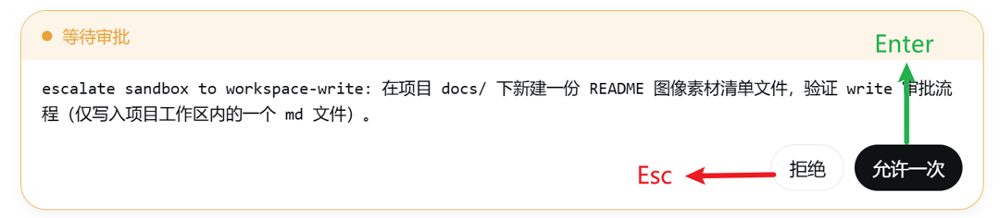
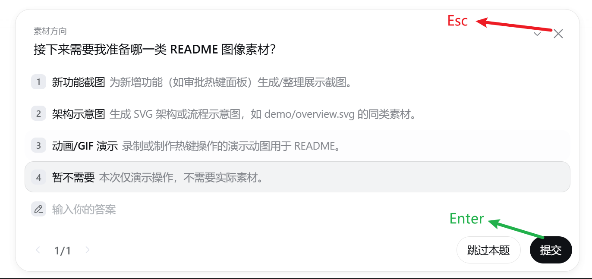
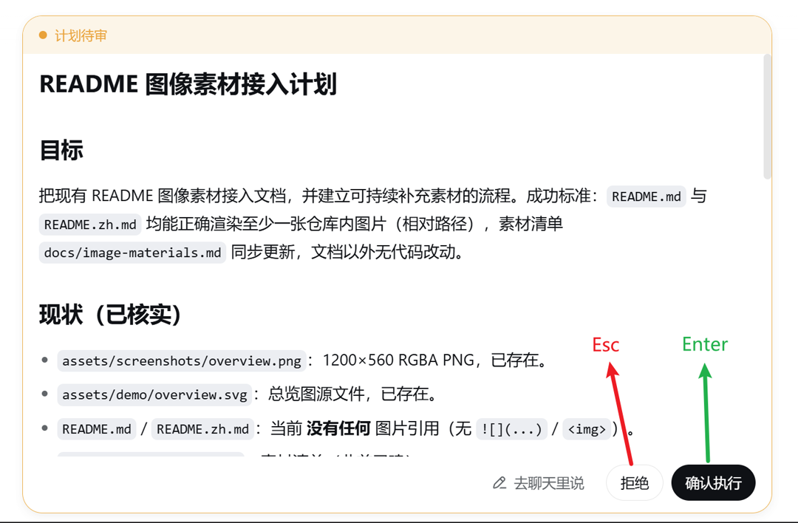

# dsh-approval-hotkeys

[](https://www.npmjs.com/package/dsh-approval-hotkeys)
[](https://github.com/SiriLee/dsh-approval-hotkeys/blob/main/LICENSE)

[DeepSeek Harness](https://github.com/deepseek-ai/deepseek-harness) 的**审批面板快捷键**插件，
作用于**所有来源**的审批（不只编辑审批）。

> [English](README.md) | 中文

刻意保持极简，一条通用规则：**Enter 总是按下确认按钮（primary 主色、动作行最右）；Esc 总是按下取消按钮**——
作用于 harness 渲染的每一类带按钮交互面板。

| 面板 | Enter → 确认 | Esc → 取消 |
| --- | --- | --- |
| 审批 `[data-approval-key]` | 允许一次 | 拒绝 |
| 选择/提问 `[data-question-key]` | 提交/下一题 | 放弃整组 |
| 计划审查 `[data-plan-review-key]` | 确认执行 | 拒绝（无拒绝则去聊天） |

面板锚点均为 harness 通用锚点，因此快捷键对 GUI 展示的**一切交互**生效——编辑审批、权限升级、
工具提问、计划审查。这就是 Claude Code 的手感：Enter 确认，Esc 取消。

### 审批面板

一切审批——编辑、权限升级、任何走 ApprovalPanel 的请求。**Enter** 按下「允许一次」，**Esc** 按下「拒绝」。

<p align="center">
  
</p>

### 提问/选择面板

工具提问（`ask_user_question`）。**Enter** 按下「提交/下一题」，**Esc** 按下「放弃整组」。

<p align="center">
  
</p>

### 计划审查面板

**Enter** 按下「确认执行」，**Esc** 按下「拒绝」（无拒绝按钮时退化为「去聊天」）。

<p align="center">
  
</p>

## 安装

```sh
dsh plugin --profile web add dsh-approval-hotkeys
```

重启 `dsh web`——或直接刷新页面（本插件纯浏览器端，host 未变时刷新即加载新 client bundle）。无需任何配置。

兼容范围：**DSH `0.2.0-rc.2` 起、不含 `0.3.0`**，以 `dsh.engines.dsh` 声明，并在两端都核实过（`0.2.0-rc.2`＝npm `latest`，`0.2.1-alpha.5`＝npm `alpha`）。自 DSH 0.2.x 起，这**一个字段就独占决定**准入——它存在时 harness 完全忽略 peer 范围——窗口不接受的版本会在启动时**整个被跳过**，所以窗口带上界，而不是放进一条未核实的新线。一次发布只对一条 DSH 线，旧线由冻结点在旧线的版本继续服务。范围策略见 [docs/release.md](docs/release.md)。

为什么还需要本插件：harness 现在自带审批快捷键，但它绑定在面板元素上、且要求焦点已在面板内（`currentTarget.contains(document.activeElement)`），所以必须先点一下面板。本插件补的正是缺的那一半——面板在场、焦点在别处。两者不会重复触发：官方处理器在 React 根内部就 `preventDefault()` + `stopPropagation()`，而本监听器挂在它上层的 `document`，并且同样忽略已被 preventDefault 的按键。

贡献者：本地 checkout 或固定 commit 安装——`dsh plugin --profile web add /path/to/dsh-approval-hotkeys` 或 `dsh plugin --profile web add github:SiriLee/dsh-approval-hotkeys#<sha>`。git 安装首次会失败：pnpm 默认阻止 git 依赖执行构建脚本，按提示在 profile 的 `pnpm-workspace.yaml` 添加 `allowBuilds` 键后重试，之后会运行插件 `prepare` 并完成安装。

## 原理

- **Enter → 确认**：点击面板的 primary 按钮——动作行最后一个按钮（「允许一次」/「提交/下一题」/
  「确认执行」）。harness 的 `Button` 组件没有稳定的 `data-variant` 属性（variant 只是 CSS
  Modules 的 hash class），因此插件锚定布局契约：**确认动作总是渲染在最后**——正是那个主色按钮。
- **Esc → 取消**：点击面板的取消按钮——审批=第一个（拒绝）、选择=header 最后（放弃整组）、
  计划审查=footer 倒数第二（拒绝；无拒绝按钮时退化为「去聊天」）。无面板时 Esc 不拦截
  （不做暂停/停止——那是 GUI「停止生成」按钮与既有快捷键的职责）。

### 守卫（刻意不做的事）

- **输入中不拦截**：焦点在 input / textarea / select / contentEditable 时交还输入框
  （`Enter` 发送、`Shift+Enter` 换行、`Esc` 收起联想都属于输入框）。
- **焦点在按钮上时 Enter 不拦截**：交给浏览器原生激活聚焦按钮、以及面板自身
  （选择弹窗的选项自带 Enter 提交）——再处理会双重触发。
- **组合键与连发不拦截**：`Ctrl/Meta/Alt+键` 与按住连发交给系统。
- **输入法组字中不拦截**：IME 确认候选词的 `Enter`（`isComposing`，或历史的 `keyCode` 229）
  是在选词，不是在应答。
- **无面板时 Esc 不拦截**：插件只作用于交互面板，绝不停止/暂停 agent。
- **运行时未确认的面板不拦截**：只要运行时能报出「此刻有哪个请求在等待应答」，插件就只应答
  那一个请求——DOM 里残留的已结束或不属于本会话的面板，不会被按位置猜着点。

### 按钮解析契约（`data-hotkey="none"`）

Enter/Esc 解析按钮**按位置**（第一个 / 最后一个 / header 最后 / footer 最后），
而非稳定的语义属性——harness 的 `Button` 组件没有可靠的 `data-role` / `data-variant`，
对不拥有面板 DOM 的 client 插件而言，位置是唯一稳定信号，因此**按钮顺序是与 harness
布局唯一的耦合点**。

当**其他插件**向面板注入按钮（工具开关、装饰控件）时，为了让这个耦合保持安全，本插件
解析确认/取消按钮时会**跳过带 `data-hotkey="none"` 标记的按钮**。任何向交互面板添加
非操作按钮的插件，**应当**打上这个标记：

```html
<button data-hotkey="none">折叠 diff</button>
```

这是一个**协作式、opt-out 的契约，而不是硬保证**。它能可靠覆盖「插件在动作行前
额外插入一个非操作按钮」这一类（例如 dsh-edit-approval 的 diff 折叠按钮）；但**不**覆盖：

- 插件注入按钮却**不遵守标记**（契约被无视），或
- 插件在真正的确认/取消按钮之间**重排 / 插入可操作按钮**（语义变了，不只是加了装饰），或
- harness 自身改变面板布局。

这些情况需要在 harness 面板 DOM 上引入稳定的语义锚点（例如
`data-role="confirm"` / `data-role="cancel"`）——那是 harness 仓库的改动，不是
client 插件能解决的。真遇到时请向 deepseek-harness 提 issue / PR。

### 设计要点

- 纯浏览器（client）插件：host 半边是空桩；全部行为是注册在单个 `ctx.effect` 里的
  一个 `document` `keydown` 监听器，卸载/HMR 时解绑。
- 依赖稳定的 ApprovalPanel DOM 契约：拒绝在前、允许一次在后、回答后按钮 disabled——
  既不可能重复应答，按钮顺序也是与 harness 唯一的耦合点。
- 面板查找先问运行时：`uiSession.sessionStatus` 给出「主视图保留的会话」（`sessions.list`
  的 `retainedBy.mainView`，即取代 `SessionListState.current` 的信号）此刻等待应答的请求，
  再按该请求 key 定位面板。运行时读得到、但报「没有待应答请求」时，插件就完全不插手；只有
  运行时**读不到**（没有 `uiSession`、快照字段被改名——即更旧或更新的宿主）才退化为
  「DOM 中第一个**可见**面板」。
- 只有真正在屏幕上的面板才可应答：落在 `inert` / `hidden` 子树内、或被 `visibility: hidden`
  隐藏的面板绝不点击（`inert` 与 `visibility` 都不会让 `offsetParent` 变空，所以这些情况需要
  显式判定，常规可见性检查抓不到）。
- `src/client/contract.ts` 在编译期钉住所读取的 harness 形状。没有它，`skipLibCheck` 会把
  被移动/改名的类型静默变成 `any`，typecheck 依旧全绿而每处读取都已失去检查。

## 开发

```sh
npm install
npm run typecheck   # tsc --noEmit（host + client + 契约钉）
npm test            # vitest（dispatch 与目标解析单测）
npm run build       # esbuild：lib/index.js + lib/client.js + .d.ts
node scripts/verify-host.mjs   # 对构建产物做端到端校验
npm run check       # 以上全部 + npm pack --dry-run
```

## 发布

首次发布需手动执行一次 `npm publish --access public`，之后由 GitHub Actions
**Trusted Publishing** 接管——推送 `v<semver>` 标签即自动带 provenance 发布。
完整步骤见 [docs/release.md](docs/release.md)。

## 安全

纯浏览器端插件：host 半面为空壳，全部行为是一个文档级 keydown 监听器，点击面板上已有的按钮。无网络请求、无文件访问、不接触任何凭据。

## 许可

[MIT](LICENSE)
